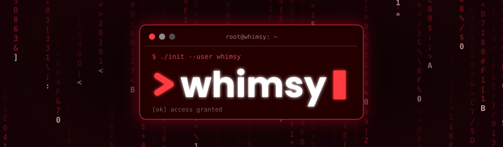

I like coding and creating cool software, from low-level C++ libraries to cozy desktop apps.

## `> ./projects`

| Project | What it does |
|:--|:--|
| 🪐 **[Xenon](https://xenon.justloofy.dev)** | A place to learn coding, step by step. *(formerly Cairn)* |
| 🧩 **[Kore-Library](https://github.com/whimsyman/Kore-Library)** | A C++ library family split into kernel ([KKore](https://github.com/whimsyman/KKore)), external ([EKore](https://github.com/whimsyman/EKore)) and internal ([IKore](https://github.com/whimsyman/IKore)) modules. |
| 🌙 **[Nora](https://github.com/whimsyman/Nora)** | No one remains alone. |
| 🧾 **[invoice-api](https://github.com/whimsyman/invoice-api)** | An API that generates invoices for my business. |
| ☕ **Cozy desktop apps** | Calm little apps: [Movies](https://github.com/whimsyman/Movies), [Weather](https://github.com/whimsyman/Weather), [Calendar](https://github.com/whimsyman/Calender) and [Timer](https://github.com/whimsyman/Timer). |

## `> ./stack`

## `> ./stats`

